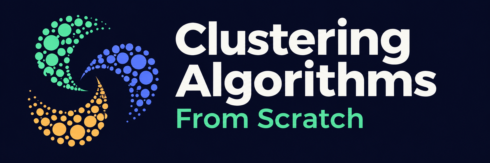

  

# Clustering Algorithms from Scratch

How does the shape of a dataset affect the clusters an algorithm finds? This project implements **K-Means** and **DBSCAN** from scratch in Python and compares them on four synthetic datasets, from well-separated blobs to interleaving moons and nested circles.

## Datasets

The datasets are generated with `scikit-learn`. Each highlights a different clustering challenge.

| Dataset | Structure | What it tests |
| --- | --- | --- |
| **Blobs** | Compact, well-separated groups | Whether the algorithms recover clearly separated clusters |
| **Anisotropic Clusters** | Stretched groups with different orientations | How elongated shapes affect cluster assignments |
| **Noisy Moons** | Two interleaving half-moons with noise | Whether the algorithms can follow curved boundaries |
| **Noisy Circles** | Two concentric rings with noise | Whether the algorithms can separate groups that share a center |

## Implemented Algorithms

### K-Means

K-Means assigns each point to the cluster with the nearest centroid. The implementation follows these steps:

1. Randomly initialize `k` centroids.
2. Assign each data point to its nearest centroid.
3. Update each centroid to the mean of its assigned points.
4. Repeat the assignment and update steps until convergence.

The project also uses the **Elbow Method** to explore possible values of `k`. The elbow plot shows where adding another cluster starts to yield a smaller reduction in the within-cluster sum of squares.

### DBSCAN

DBSCAN (*Density-Based Spatial Clustering of Applications with Noise*) builds clusters by connecting dense neighborhoods. Two parameters control how clusters form:

| Parameter | Role |
| --- | --- |
| `eps` | The maximum distance for two points to be considered neighbors |
| `min_samples` | The minimum number of points in a neighborhood, including the point itself, for it to qualify as a core point |

DBSCAN expands clusters through connected core points and includes nearby border points. Points outside these clusters are labeled as **noise**. This allows the algorithm to discover irregular shapes without specifying the number of clusters in advance.

## Visualization

The project visualizes the original datasets, the cluster assignments produced by each algorithm, and the K-Means elbow plots.

The **Noisy Circles** dataset is a useful place to see the difference. Both rings share a center, so proximity to a centroid cannot separate the inner ring from the outer one. With suitable density parameters, DBSCAN can follow each ring as a separate cluster.

## Evaluation Metrics

The predicted clusters are compared with the known labels of the synthetic datasets using three metrics:

| Metric | What it measures |
| --- | --- |
| **F-Measure** | Combines precision and recall into a single score |
| **Normalized Mutual Information (NMI)** | Measures how much information the predicted clusters share with the true labels, regardless of cluster numbering |
| **Rand Score** | Measures the fraction of point pairs that both partitions group together or both keep apart |

## Technologies Used

**Python** · **NumPy** · **pandas** · **scikit-learn** · **Matplotlib**

## Key Learning Outcomes

- Implement the assignment and update steps that drive K-Means.
- Understand how core points, border points, and noise shape DBSCAN clusters.
- Explain why dataset geometry matters when choosing a clustering algorithm.
- Interpret clustering plots alongside scores computed from known labels.

## Future Improvements

- Compare both implementations with their `scikit-learn` counterparts.
- Add **Silhouette Score** to evaluate cluster separation without ground-truth labels.
- Test both algorithms on real-world datasets.
- Implement **Hierarchical Clustering** and compare it with K-Means and DBSCAN.

## Author

**Yasir Abdullah Al-Adwani**  
Artificial Intelligence Graduate · [GitHub](https://github.com/Yasir-Aladwani)
